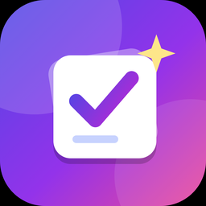
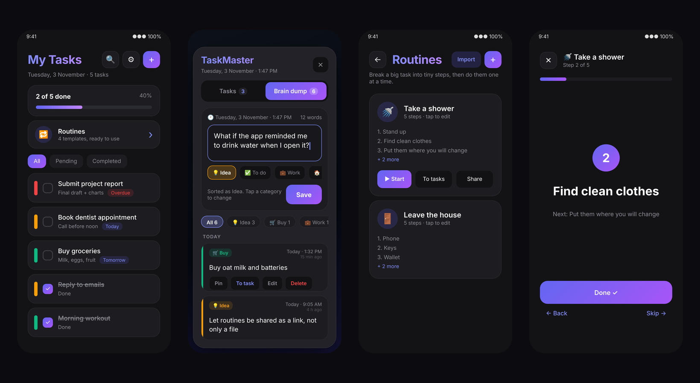
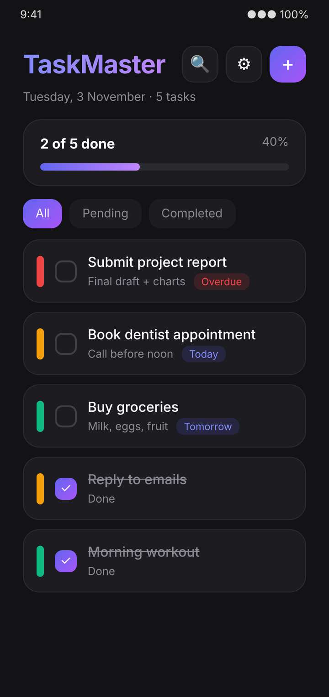
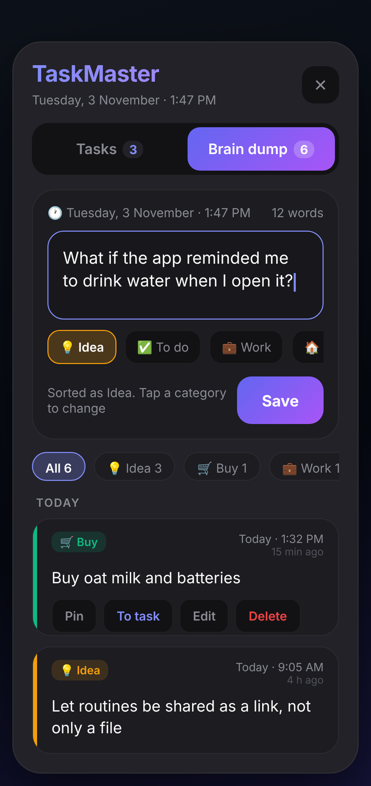
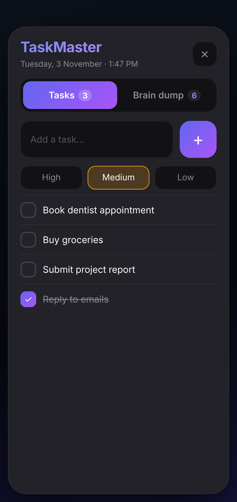
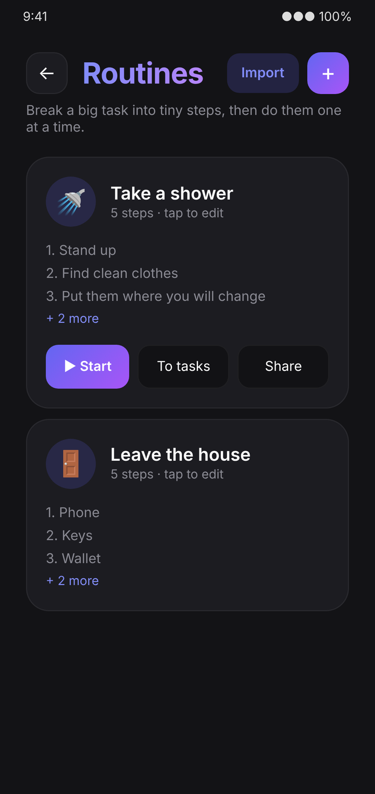
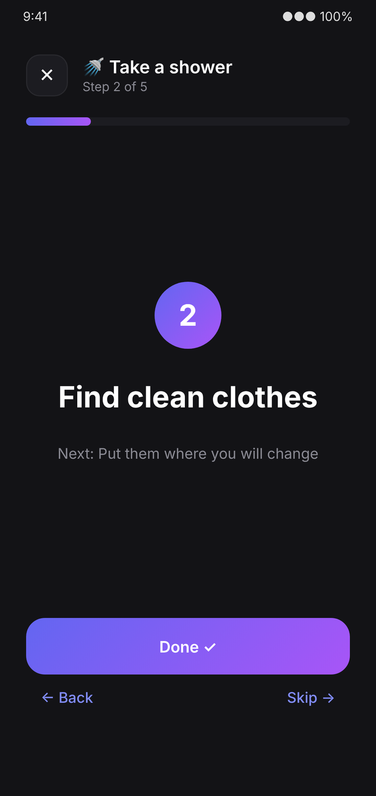
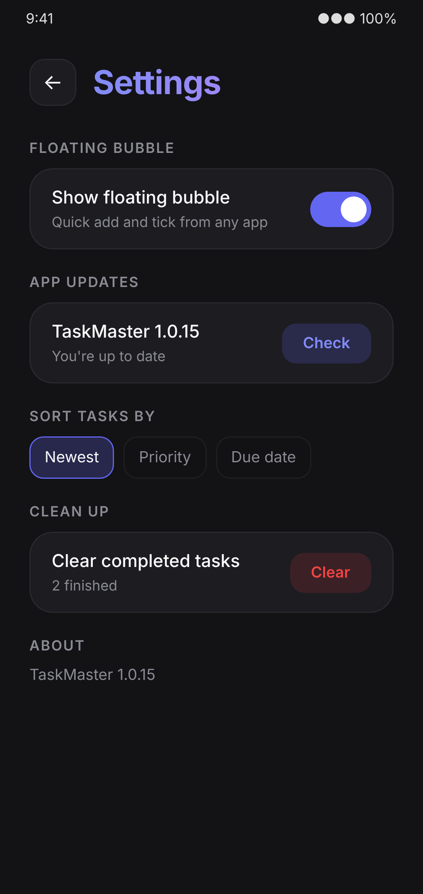
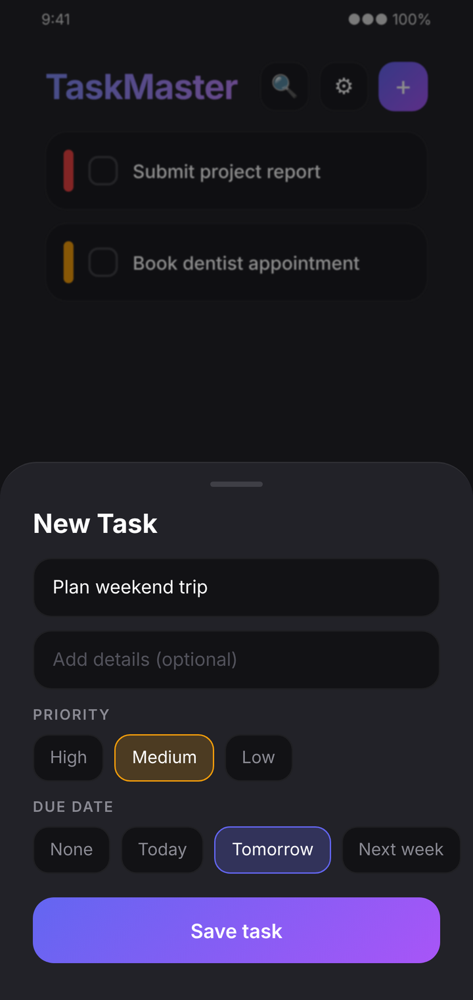

<div align="center">



# TaskMaster

**A fast, beautiful to-do list for Android, with a floating bubble that lets you add and tick tasks from any app.**

[](https://github.com/digitalboy69/To-do-list-app/actions/workflows/build-apk.yml)
[](https://github.com/digitalboy69/To-do-list-app/releases/latest)
[](LICENSE)


[**Download the APK**](https://github.com/digitalboy69/To-do-list-app/releases/latest)



</div>

## Screenshots

> These images are design previews rendered from the app's real colours and layout, not device screenshots. Real screens may differ slightly.

| Home | Brain dump (popup) | Popup: tasks |
| :---: | :---: | :---: |
|  |  |  |

| Routines | Run a routine | Settings |
| :---: | :---: | :---: |
|  |  |  |

| New task |
| :---: |
|  |

Built with Kotlin and Jetpack Compose (Material 3), with a dark indigo and purple look.

## Features

- **Smooth motion everywhere**: pages slide over the home screen with a depth effect, cards pop in one after another, every button squeezes with a springy press, a soft colour glow drifts behind the home screen, and the popup tabs share one sliding pill
- **Brain dump**: capture any thought in a second, from anywhere. Every note is stamped with its exact date and time, auto-sorted into a category, searchable, pinnable and can become a task
- **Routines (templates)**: turn a big task into a sequence of small steps, save it once, and use it again and again. Built with ADHD and executive dysfunction in mind (see below)
- Add tasks with a title, optional details and a priority (High / Medium / Low)
- Check tasks off, delete them, filter by All / Pending / Completed
- Tasks are saved on the device and survive app restarts
- Same dark/indigo-purple look, with the "push back" effect behind the New Task sheet
- **Due dates** (Today / Tomorrow / Next week), shown on each card and in red once overdue
- **Edit** any task by tapping it, **search**, and **sort** by newest, priority or due date
- **Progress card** with an animated bar, plus a confetti burst when you finish everything
- **Settings** page (gear icon): floating bubble on/off, check for updates, sort order, clear completed
- Animated **permission guide** that opens the exact settings page, so the only thing left is flipping the switch
- **Floating bubble**: an always-on-screen icon you can drag anywhere. Tap it for a tall popup with two tabs, **Tasks** (add and tick) and **Brain dump** (capture ideas), without leaving the app you're in

## Brain dump

For the thought that shows up at the worst moment. Get it out of your head in a second, sort it out later.

**Capture, instantly**
- **Hold the floating bubble** and the popup opens straight on Brain dump with the keyboard already up. A tap opens the popup on whichever tab you used last.
- **Notification button**: the bubble's notification has a **Brain dump** button.
- **App icon shortcut**: long-press the TaskMaster icon and pick **Brain dump**.
- **Share sheet**: share any text or link from another app (browser, chat, notes) and choose **Brain dump**. It is saved at once, with no screen to deal with.
- **Never lose a draft**: what you are typing is kept even if you close the popup halfway through a thought.

**Clear and precise**
- Every note carries its **exact date and time** ("Today · 1:47 PM", "Mon 2 Nov · 9:15 AM") and how long ago it was ("15 min ago"). The capture box shows the live date and time before you save.
- Notes are grouped by day, with **Pinned** notes on top.
- **Categories**: Idea, To do, Work, Personal, Buy, Learn, Link and Random. TaskMaster guesses one from what you wrote (a link becomes *Link*, "buy oat milk" becomes *Buy*), and you can tap a different one. Filter by category with live counts.

**Powerful**
- **Search** across all your notes.
- **To task** turns a note into a real task (the first line becomes the title) and marks the note as done, so nothing is lost.
- **Edit** the text or category later; the original time is kept.
- **Pin** what matters, **Delete** with a two-tap safety check.
- **Export** everything from the Brain dump screen as plain text, grouped by category with dates, through the share sheet.
- Open the full screen version from the **Brain dump** card on the home screen. It is the same panel as the popup, so both always match.

## Routines: templates for big tasks

"Take a shower" is one task, but it hides a lot of small decisions. A **routine** lists them for you:

1. Stand up
2. Find clean clothes
3. Put them where you will change
4. Get everything ready (towel, soap, shampoo)
5. Go to the shower

- **Create once, use forever.** Open **Routines** on the home screen, tap **+**, name it, pick an icon and list the steps (reorder with the arrow, remove with the cross).
- **Run one step at a time.** Tap **Start** and the app shows a single big instruction and a single **Done** button, with the next step as a hint. There is no list to scan and nothing to decide, which is what makes it easier to begin. The screen stays on while a routine runs, and finishing the last step plays confetti. You can go **Back** or **Skip**.
- **Or add the steps to your task list** with **To tasks**; they land in order, with step 1 on top.
- **Share as a file.** **Share** sends the routine as a small `.taskmaster` file through any app (chat, email, cloud drive). The other person taps **Import** on their Routines page and picks the file.
- **Starter routines.** An empty Routines page offers *Add example routines* (shower, morning start, leave the house, quick tidy) so there is something to try straight away.

The `.taskmaster` file is plain JSON, so you can write one by hand:

```json
{
  "format": "taskmaster-routines",
  "version": 1,
  "routines": [
    { "name": "Take a shower", "emoji": "🚿",
      "steps": ["Stand up", "Find clean clothes", "Get everything ready", "Go to the shower"] }
  ]
}
```

## Download the app

Get the latest APK from the **[Releases page](https://github.com/digitalboy69/To-do-list-app/releases/latest)**: open it, tap `TaskMaster.apk` under *Assets*, and install it (allow "install unknown apps" when asked).

## In-app updates

When the app opens it checks the latest GitHub Release. If a newer version exists, it asks **Update now** or **Later**. *Update now* downloads the APK inside the app (with a progress bar) and opens the Android installer; the first time, Android asks you to allow TaskMaster to install updates. *Later* hides the prompt until you open the app again. You can also tap **Check** under **Settings > App updates** at any time; it shows the installed version and tells you if you are up to date.

## Floating bubble

1. Open TaskMaster, tap the gear icon, and turn on the **Floating bubble** switch.
2. The first time, a short animated guide explains the permission and **Open settings** takes you straight to TaskMaster's page. Flip the switch, press back, and the bubble starts.
3. The bubble appears on screen. Drag it anywhere (it snaps to the nearest edge). **Tap** it to open the popup (Tasks and Brain dump tabs) or **hold** it to jump straight to Brain dump. Tap **Open TaskMaster** inside the popup to jump to the full app.
4. Turn it off with the same switch, or with **Turn off** on the small "bubble is on" notification.

After a couple of idle seconds the bubble tucks into the screen edge, faded and mostly hidden, leaving just a sliver to tap; touching it slides it back out at full colour. It shows how many tasks are pending, comes back after a reboot if you left it on, and shares its task list with the app, so both always match.

## Build the APK with GitHub Actions

1. Push this project to a GitHub repo (branch `main`).
2. Open the **Actions** tab. The **Build APK** workflow runs on every push (or start it with **Run workflow**).
3. When it finishes, open the run and download **TaskMaster-apk** from *Artifacts*. Unzip it and install `TaskMaster.apk` on your phone (allow "install unknown apps").

Every push to `main` also publishes a new **Release** (`v1.0.<run number>`) with `TaskMaster.apk` attached, so the newest APK is always on the Releases page.

## Build locally

Open the folder in Android Studio (Ladybug or newer) and press Run, or with Gradle 8.9 and JDK 17 installed:

```bash
gradle assembleDebug
```

The APK is written to `app/build/outputs/apk/debug/app-debug.apk`.

## Project layout

```
app/src/main/java/com/taskmaster/app/
  MainActivity.kt          entry point, edge-to-edge setup
  ShareToDumpActivity.kt   saves text shared from other apps as a note
  TaskViewModel.kt         state + actions (add / toggle / delete / filter)
  data/Task.kt             Task model, Priority, TaskFilter
  data/TaskRepository.kt   JSON persistence in SharedPreferences
  data/TaskStore.kt        shared task list used by the app and the bubble
  data/Routine.kt          routine model and the .taskmaster JSON format
  data/Note.kt             brain-dump note, categories and auto-detection
  data/NoteStore.kt        saved notes and the unsent draft
  data/RoutineStore.kt     saved routines, import and starter examples
  overlay/OverlayService.kt   foreground service that draws the bubble and popup
  overlay/QuickTasksPopup.kt  bubble + tabbed popup UI
  overlay/OverlaySettings.kt  on/off state and bubble position
  overlay/BootReceiver.kt     restores the bubble after reboot
  ui/BubbleToggle.kt       on/off switch and permission flow
  ui/UpdateUi.kt           "Check" card and "Update available" dialog
  ui/SettingsScreen.kt     settings page
  ui/PermissionGuide.kt    animated permission guide
  ui/BrainDump.kt          capture box, filters, search and notes list (app + popup)
  ui/BrainDumpScreen.kt    full-screen Brain dump with export
  ui/NoteFormat.kt         dates, times, day grouping and text export
  ui/HomeShortcuts.kt      Brain dump and Routines cards on the home screen
  ui/RoutinesScreen.kt     routines list, import, add-to-tasks, share
  ui/RoutineEditor.kt      create / edit a routine
  ui/RoutineRunner.kt      one-step-at-a-time run mode
  ui/RoutineShare.kt       share a routine as a file, read an imported file
  ui/HomeWidgets.kt        progress card, search, due-date chips
  ui/Confetti.kt           confetti burst
  update/UpdateChecker.kt  checks GitHub releases, downloads and installs the APK
  ui/TaskApp.kt            all screens and components
  ui/theme/Theme.kt        colors, gradient, theme
```

## License

Released under the [MIT License](LICENSE). See [CONTRIBUTING.md](CONTRIBUTING.md) if you want to help.

## Notes

- The workflow builds a signed **release** APK with R8 (code and resource shrinking). The signing key is kept in `.github/workflows/build-apk.yml` on purpose, so every build has the same signature and updates install over each other. That is fine for a personal sideloaded app; for anything public, replace it with your own private key via the repo secrets `KEYSTORE_BASE64`, `KEYSTORE_PASSWORD` and `KEY_ALIAS`.
- Because the app is installed outside the Play Store and asks to draw over other apps, Google Play Protect may warn about it. Tap **Install anyway** (or turn off *Scan apps with Play Protect* briefly).
- The prototype used the Poppins font. This app uses the system font to avoid bundling font files; to match exactly, drop the Poppins `.ttf` files into `app/src/main/res/font/` and reference them in a `FontFamily`.
- Package name / app id: `com.taskmaster.app` (change it in `app/build.gradle.kts` and move the source folders if you want your own).
